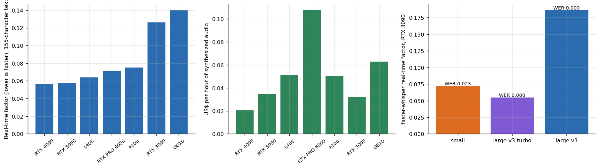

# Voice: speech-to-text and text-to-speech bench

**How fast, and how expensive, are speech synthesis, transcription and a full-duplex voice model on rented GPUs, and what happens on the first call?** F5-TTS, faster-whisper, OpenVoice (CPU) and NVIDIA PersonaPlex measured with real-time factors, cold starts kept in the data and priced per hour of audio.



## Why this matters

Voice products live or die on one ratio, the **real-time factor** (seconds of compute per second of audio). Under 1 is faster than real time; a voice agent needs far under 1 because it also waits for a language model. The less obvious lesson of this study is the **cold start**: a synthesis call that downloads its model takes minutes, and an average that includes it is meaningless. The cold calls are therefore separated, listed and explained rather than hidden in or out of a mean.

## Headline results

| Finding | Evidence |
|---|---|
| F5-TTS is faster than real time on every card once warm | median RTF 0.056 on the RTX 4090 to 0.140 on the GB10 (155-character text) |
| An hour of synthesized audio costs cents | as little as US$ 0.021 at the prices paid |
| 2 of 32 F5-TTS calls were cold-start outliers | the worst took 44 times the audio duration because the model was downloaded during the call (`results/tables/f5tts_cold_start_outliers.md`) |
| faster-whisper large-v3-turbo is the sweet spot on an RTX 3090 | RTF 0.055 against 0.186 for large-v3, WER 0.000 on a 66-second clip |
| OpenVoice runs on a laptop CPU | tone conversion RTF 0.93, text-to-speech RTF 6.5 on a 10-core i7 in Docker (first run includes warm-up) |
| PersonaPlex 7B (full duplex, 40 s of audio) | warm real-time factor 0.77 to 1.08 across 5 GPUs; the first call took 150 to 240 seconds on four of the five machines (the cause was not logged), and one RTX 5090 run took 640 |

## What this does not show

The recognizer's accuracy comes from **one** 66-second English clip and is not a benchmark of word error rate. TTS quality (naturalness, intelligibility) was not rated. Voice cloning, noisy audio and other languages were not tested. PersonaPlex failed on the ARM GB10 because a Python module was missing in that environment (a software gap, not a hardware limit). **No synthesized audio is redistributed** (F5-TTS weights are non-commercial, PersonaPlex has its own terms).

## Repository map

```
src/voice/   libs.py (F5-TTS, faster-whisper timing), gpu_suite.py (faster-whisper models, OpenVoice), run_gated2.sh (PersonaPlex and FLUX sessions)
analysis/    tts_stt.py
data/        libs_runs.csv, sandbox_metrics.csv, openvoice_cpu_local.csv, media_gated_runs.csv
results/     figures and tables;  tests/  conclusions that must keep following from the data
```

## Reproduce

```bash
make setup && make all
python src/voice/libs.py f5_tts faster_whisper            # on a CUDA machine
```

## Limits

A few calls per card, two to three text lengths, a single host per card. Cold-start behavior depends on the host's network and disk, so those outliers say how a rented machine behaves on its first call, not how a model behaves.

## Articles that use this repository

- [Speech workloads on rented GPUs](https://www.kaggle.com/code/lucasrangelss/speech-workloads-on-rented-gpus)
- [What fits and what fails across seven GPUs](https://www.kaggle.com/code/lucasrangelss/what-fits-and-what-fails-across-seven-gpus)
- Related: [image-video-generation-bench](https://github.com/LucasRangelSSouza/image-video-generation-bench), [vast-gpu-benchmark-harness](https://github.com/LucasRangelSSouza/vast-gpu-benchmark-harness)

Licence: MIT for this code; F5-TTS weights are CC-BY-NC, see `LICENSE_NOTES.md` for each tool.
